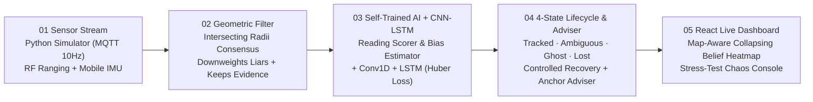

# InSight AI · GhostTrack — Resilient Indoor Positioning

**Team**: Kajukatli (Diptanshu Jamar)  
**Tagline**: *Ambiguity-aware, explainable indoor positioning via geometric outlier rejection and predictive dead-reckoning.*

---

## 1. The Problem: Why Standard Indoor Positioning Fails

Bluetooth Low Energy (BLE) and Ultra-Wideband (UWB) indoor localization fail in three critical ways in real deployments (warehouses, hospitals, malls, robotics):
1. **Signals Lie (NLOS Wall Bounces)**: Radio waves bounce off walls, making distance readings strictly longer than true distance and causing trilateration algorithms to jump erratically.
2. **Blind Spots Freeze Tracking**: With sparse infrastructure, a target in a blind spot loses anchor coverage and conventional tracking freezes completely.
3. **ML is Brittle**: End-to-end neural networks that memorize room-specific noise fail in unseen rooms and during network dropouts.

---

## 2. The GhostTrack Pipeline & 4 Explicit States



### The 4 Tracking States
- **`Tracked`**: $\ge 3$ geometrically consistent anchors; verified fix with sharp belief lock.
- **`Ambiguous`**: Only 2 clean anchors visible (bimodal circle intersection) or unverified post-blackout recovery; the heatmap preserves **multiple plausible regions** rather than guessing blindly.
- **`Ghost`**: Zero/insufficient anchors visible; fuses **LSTM momentum memory** with **mobile IMU ($a_x, a_y, g_z$)** while spatial uncertainty ($\sigma$) widens monotonically.
- **`Lost`**: If a full blackout exceeds the timeout threshold ($5.0\text{ s}$), stops inventing a fictional path and explicitly transitions to `Lost`.

---

## 3. All 12 PPT USPs Implemented

| USP | Feature | Implementation |
|---|---|---|
| **01** | **Ambiguity-Aware Tracking** | Computes exact bimodal circle intersections in [`engine/contradiction.py`](file:///Users/diptanshujamar/Documents/codeapex/engine/contradiction.py) and renders multi-modal lobes in [`backend/belief.py`](file:///Users/diptanshujamar/Documents/codeapex/backend/belief.py). |
| **02** | **Explainable Anchor Recovery** | [`engine/adviser.py`](file:///Users/diptanshujamar/Documents/codeapex/engine/adviser.py) ranks offline/NLOS anchors by symmetry-breaking gain & GDOP reduction with 1-click restoration in the UI. |
| **03** | **Measured Reliability** | Displays calibrated `"X% probability within 2 m"` beside the fixed-size target marker and validates empirical coverage in [`scripts/train_and_evaluate.py`](file:///Users/diptanshujamar/Documents/codeapex/scripts/train_and_evaluate.py). |
| **04** | **Sensor Diagnostics** | Keeps all readings with continuous reliability weights $w \in [0, 1]$, AI bias estimates, and highlights suspicious NLOS links in red on the floor plan. |
| **05** | **Ghost Mode, Visible Limits** | Short-term LSTM + IMU dead-reckoning with growing $\sigma(t)$ that transitions to `Lost` after prolonged blackout in [`model/ghost.py`](file:///Users/diptanshujamar/Documents/codeapex/model/ghost.py). |
| **06** | **Controlled Recovery** | Returning anchor fixes must pass consecutive consistency verification frames before transitioning back to `Tracked`. |
| **07** | **Map-Aware Tracking** | Interior floor-plan walls block impossible moves during dead-reckoning and mask the 2D belief heatmap. |
| **08** | **Judge-Controlled Testing** | Live Stress-Test Console: draw custom walls on the map, place anchors, drag NLOS/noise sliders, toggle anchors, or trigger a full blackout. |
| **09** | **Failure Replay** | Simultaneously runs and benchmarks **Naive Trilateration**, **Geometric Filter**, and **GhostTrack** on identical telemetry streams. |
| **10** | **Freshness-Aware Tracking** | Tracks per-packet measurement age (`measurement_age_ms`) and exponentially decays weights of stale packets. |
| **11** | **Auditable Decisions** | Real-time scrolling audit log recording every state transition, liar downweight reason, recovery verification, and adviser update. |
| **12** | **Local, No-Cloud Operation** | Runs 100% locally with one command (`./run_demo.sh`), including an embedded Python MQTT broker fallback if Mosquitto/Docker isn't installed. |

---

## 4. Quickstart (One Command)

### Run the Full Live Demo (MQTT Broker + Simulator + FastAPI Backend + React Dashboard)
```bash
./run_demo.sh
```
*(On Windows: `run_demo.bat`)*

Then open **`http://localhost:5173`** in your browser.

### Run the Automated Test Suite
```bash
.venv/bin/pytest tests/ -v
```

### Train Self-Trained AI Models & Run Unseen-Room Benchmark
```bash
.venv/bin/python -m scripts.train_and_evaluate
```
*(Saves trained weights to `model/weights/` and real measured metrics to `data/evaluation_report.json`.)*

---

## 5. Live Hackathon Demo Script for Judges (90 Seconds)

1. **Normal Tracking (`Tracked`)**: Point out the collapsing emerald belief heatmap, the fixed-size target dot with its `"~94% within 2m"` callout, and the red dashed NLOS link whenever the target passes behind an interior wall.
2. **Signals Lie (Inject NLOS Bias)**: Drag the **NLOS Wall-Bounce Bias** slider up to `+4.5 m`. Show how the red **Naive Trilateration** dot jumps wildly across the room while **GhostTrack** downweights the liar (`w < 0.15`) and stays locked on the true path.
3. **Ambiguity-Aware Tracking (`Ambiguous`)**: Click two anchors (`A3` and `A4`) to turn them **OFFLINE**. Watch the state switch to **`Ambiguous`** with two yellow bimodal modes, and point to the **Explainable Anchor Recovery Adviser** recommending which anchor to restore first and why.
4. **Blackout $\rightarrow$ `Ghost` $\rightarrow$ `Lost` $\rightarrow$ `Controlled Recovery`**: Click **⚡ Trigger Full Blackout**. Watch the heatmap turn purple and expand as **Ghost Mode** dead-reckons with LSTM + IMU, transition to **`Lost`** after 5 seconds, and then click **↺ Restore All Anchors** (or click the **▶ Run Scripted Chaos Scenario** button) to show **Controlled Recovery** verifying the fix before locking back onto `Tracked`.
