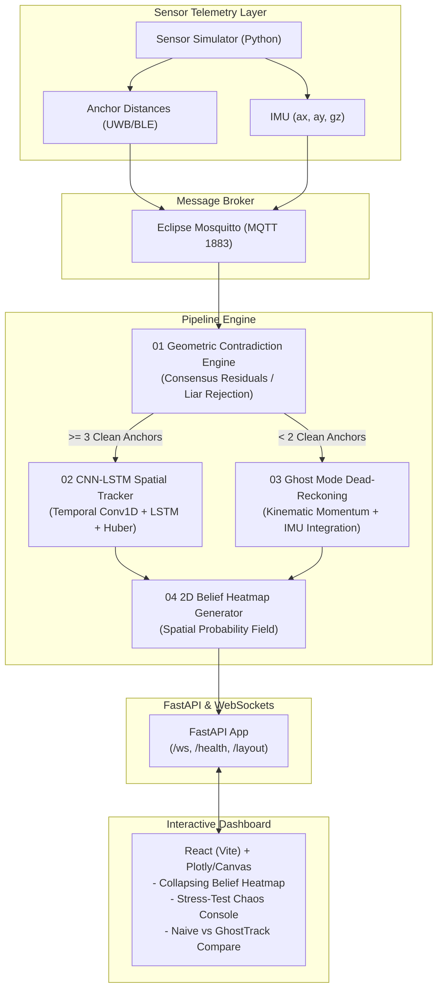

# InSight AI / GhostTrack: Resilient Indoor Positioning

> **Resilient Indoor Positioning via Geometric Outlier Rejection and Predictive Dead-Reckoning**

Indoor positioning with Bluetooth Low Energy (BLE) and Ultra-Wideband (UWB) suffers from three fatal modes of failure in real-world industrial and clinical deployments:
1. **Signals Lie (Multipath / NLOS)**: Wall bounces make distance readings strictly longer than true distance, causing trilateration solutions to erratically jump.
2. **Blind Spots (Coverage Gaps)**: With sparse or obstructed anchors, targets lose visibility to anchors, freezing conventional positioning systems.
3. **Brittle ML (Overfitting to Noise)**: Deep learning models trained on raw signals fail in unseen room layouts and during intermittent network dropouts.

**GhostTrack** solves these fundamental flaws using a robust, decoupled pipeline:
- **01 Sensor Simulator**: High-fidelity RF ranging simulator with physical NLOS wall penetration models and synthetic IMU kinematics.
- **02 Geometric Contradiction Engine**: Deterministic, zero-label geometric outlier rejection using intersecting circle consensus to identify and discard "liar" anchors before any neural inference.
- **03 CNN-LSTM Tracker**: 1D temporal convolution smoothing coupled with LSTM trajectory momentum, trained with Huber loss for outlier-resilient coordinate regression and uncertainty estimation ($\sigma$).
- **04 Ghost Mode (Inertial Dead-Reckoning)**: Predictive fallback when coverage is lost ($<2$ anchors), fusing the LSTM's momentum memory with high-rate IMU telemetry. Spatial uncertainty expands gracefully and snaps back to high confidence upon anchor re-acquisition.
- **05 FastAPI & WebSockets**: Low-latency event streaming pushing position coordinates, variance, and 2D belief-region heatmaps.
- **06 React Live Dashboard**: Real-time collapsing belief heatmaps, multi-anchor telemetry panels, and an interactive **Stress-Test Console** enabling judges to break tracking on purpose (inject massive noise, inject NLOS bias, disconnect anchors, draw custom room walls).

---

## Architecture Overview



---

## Repository Structure

```
├── .env.example              # Environment variables template
├── docker-compose.yml        # Mosquitto broker setup
├── requirements.txt          # Python dependencies
├── package.json              # Monorepo scripts
├── run_demo.sh               # One-command demo runner (macOS/Linux)
├── run_demo.bat              # One-command demo runner (Windows)
├── docs/
│   └── contracts.md          # Strict MQTT and WebSocket data contracts
├── shared/
│   ├── __init__.py
│   └── schemas.py            # Pydantic data schemas
├── simulator/
│   ├── __init__.py
│   ├── geometry.py           # 2D segment intersection and collision physics
│   ├── trajectory.py         # Smooth kinematics and noisy IMU simulation
│   └── sim.py                # Main MQTT simulator & dataset exporter
├── engine/                   # Geometric Contradiction Engine
├── model/                    # CNN-LSTM Tracker & Ghost Mode
├── backend/                  # FastAPI WebSocket & REST streaming service
├── frontend/                 # React + Vite interactive dashboard
├── scripts/
│   └── embedded_broker.py    # Zero-dependency fallback MQTT broker
└── tests/
    ├── test_contracts.py
    └── test_simulator.py
```

---

## Quickstart (One Command)

### macOS / Linux
```bash
./run_demo.sh
```

### Windows
```cmd
run_demo.bat
```

The runner automatically verifies Python `.venv`, starts the MQTT broker (local binary, Docker, or embedded fallback), launches the FastAPI backend and simulator, and starts the Vite React dashboard at `http://localhost:5173`.
